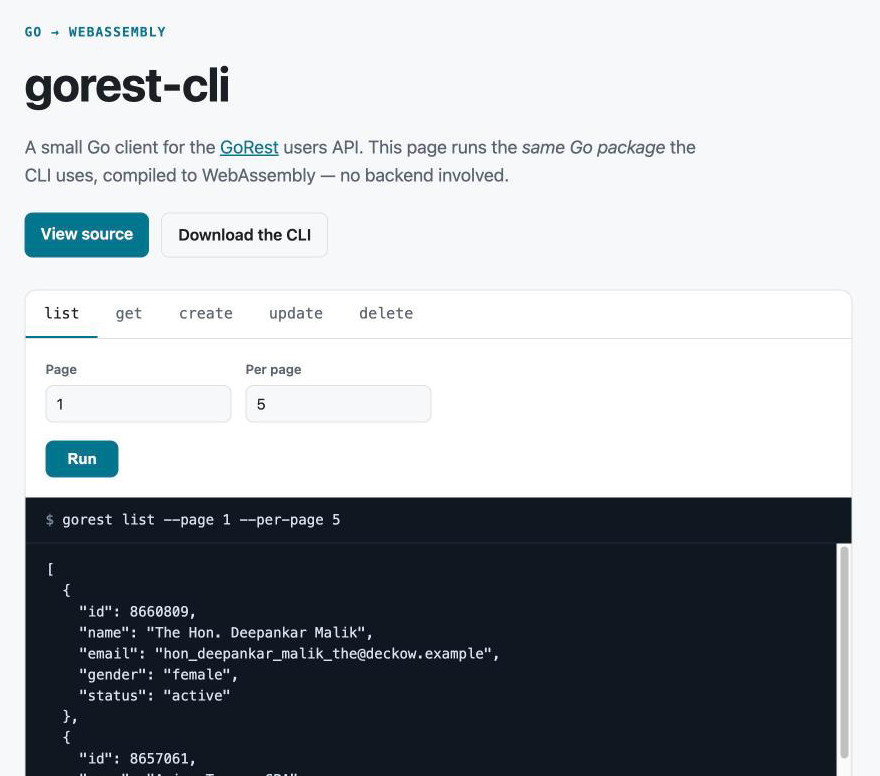

# gorest-cli

[](https://github.com/andreanicte02/gorest-cli/actions/workflows/ci.yml)
[](https://github.com/andreanicte02/gorest-cli/releases/latest)
[](https://andreanicte02.github.io/gorest-cli/)

*[Leer en español](#en-español)*

A small, dependency-free Go client and command-line tool for managing users on
[GoRest](https://gorest.co.in), a free public REST API for testing. The same Go code also
runs **in your browser** through WebAssembly.

**▶ Try it live: <https://andreanicte02.github.io/gorest-cli/>**

[](https://andreanicte02.github.io/gorest-cli/)

## What it does

GoRest hosts a fake list of users that anyone can read, and that you can modify with a free token.
This project lets you **list, view, create, update and delete** those users in three ways:

| Where | How | Needs |
|---|---|---|
| **Browser** | Open the [live demo](https://andreanicte02.github.io/gorest-cli/) and click *Run* | Nothing (a token only for writes) |
| **Terminal** | `gorest list`, `gorest get 123`, … | A binary from [Releases](https://github.com/andreanicte02/gorest-cli/releases/latest) or `go install` |
| **Go code** | `import "github.com/andreanicte02/gorest-cli/gorest"` | Go 1.23+ |

All three share one Go package, so a fix or feature lands everywhere at once.

## How it works

```
                    ┌──────────────────────────┐
                    │  gorest/  (Go package)   │  typed models, context, timeouts,
                    │  List/Get/Create/Update/ │  structured API errors, unit tests
                    │  Delete                  │
                    └────────────┬─────────────┘
                 ┌───────────────┴───────────────┐
      ┌──────────▼──────────┐         ┌──────────▼──────────┐
      │ cmd/gorest  (CLI)   │         │ cmd/wasm (browser)  │
      │ native binary for   │         │ compiled to .wasm,  │
      │ macOS/Linux/Windows │         │ exposed to JS via   │
      └──────────┬──────────┘         │ syscall/js          │
                 │                    └──────────┬──────────┘
                 │      HTTPS (net/http)         │ net/http → browser fetch()
                 └───────────────┬───────────────┘
                         ┌───────▼────────┐
                         │ gorest.co.in   │
                         │ /public/v2     │
                         └────────────────┘
```

- **No backend.** The demo is a static page on GitHub Pages; your browser talks to GoRest directly.
- **Automated.** GitHub Actions runs `go vet` and the tests on every push, redeploys the demo,
  and publishes cross-platform binaries with GoReleaser whenever a `v*` tag is pushed.

## Install

```sh
go install github.com/andreanicte02/gorest-cli/cmd/gorest@latest
```

Or download a binary for Linux, macOS or Windows from the [releases page](https://github.com/andreanicte02/gorest-cli/releases/latest).

## Usage

Reading is public. Writing needs a free token from <https://gorest.co.in/my-account/access-tokens>:

```sh
export GOREST_TOKEN=your-token
```

```sh
gorest list --page 1 --per-page 5
gorest get 8660809

gorest create --name "Ada Lovelace" --email ada@example.com --gender female
gorest update 8660809 --status inactive
gorest delete 8660809

gorest list | jq '.[].email'
```

Errors from the API are reported clearly:

```console
$ gorest get 1
error: gorest: 404: Resource not found
$ gorest create --name Ada --email taken@example.com --gender female
error: gorest: 422: email has already been taken
```

As a library:

```go
c := gorest.New(os.Getenv("GOREST_TOKEN"))
user, err := c.CreateUser(ctx, gorest.User{Name: "Ada", Email: "ada@example.com", Gender: "female", Status: "active"})

var apiErr *gorest.APIError
if errors.As(err, &apiErr) && apiErr.StatusCode == 422 {
	for _, f := range apiErr.Fields {
		fmt.Println(f.Field, f.Message)
	}
}
```

## Project layout

```
gorest/       API client package + tests
cmd/gorest/   CLI
cmd/wasm/     WebAssembly bindings for the browser demo
web/          Static demo page (deployed to GitHub Pages)
docs/         Screenshots
```

## Development

```sh
make test    # go vet + go test -race
make build   # ./bin/gorest
make serve   # build the wasm demo and serve it on http://localhost:8080
```

Releases are cut by pushing a tag: `git tag v1.1.0 && git push --tags`.

## Background

This started in 2021 as a university assignment (*Software Avanzado*, USAC): a menu-driven
console program that exercised POST/GET/PUT/DELETE against GoRest. It was later rewritten
into an idiomatic, tested Go package with a proper CLI and a WebAssembly demo.

---

## En español

**gorest-cli** es un cliente en Go para la API pública [GoRest](https://gorest.co.in), que
tiene una lista de usuarios de prueba. Sirve para **listar, consultar, crear, modificar y
eliminar** usuarios de tres formas:

- **En el navegador:** entra a la [demo en vivo](https://andreanicte02.github.io/gorest-cli/) y
  presiona *Run*. No hay servidor propio: el código Go está compilado a WebAssembly y corre en tu navegador.
- **En la terminal:** descarga el binario desde [Releases](https://github.com/andreanicte02/gorest-cli/releases/latest)
  y usa comandos como `gorest list` o `gorest get 123`.
- **Como librería de Go:** importa el paquete `gorest` en tu propio código.

Para leer no se necesita nada. Para crear, modificar o eliminar se necesita un token gratuito de
GoRest (`export GOREST_TOKEN=...` o pegarlo en la demo; nunca se guarda).

Empezó en 2021 como la Práctica 1 de *Software Avanzado* (USAC) y se reescribió con pruebas
unitarias, CI con GitHub Actions, binarios para cada sistema operativo y la demo web.

## License

[MIT](LICENSE)
